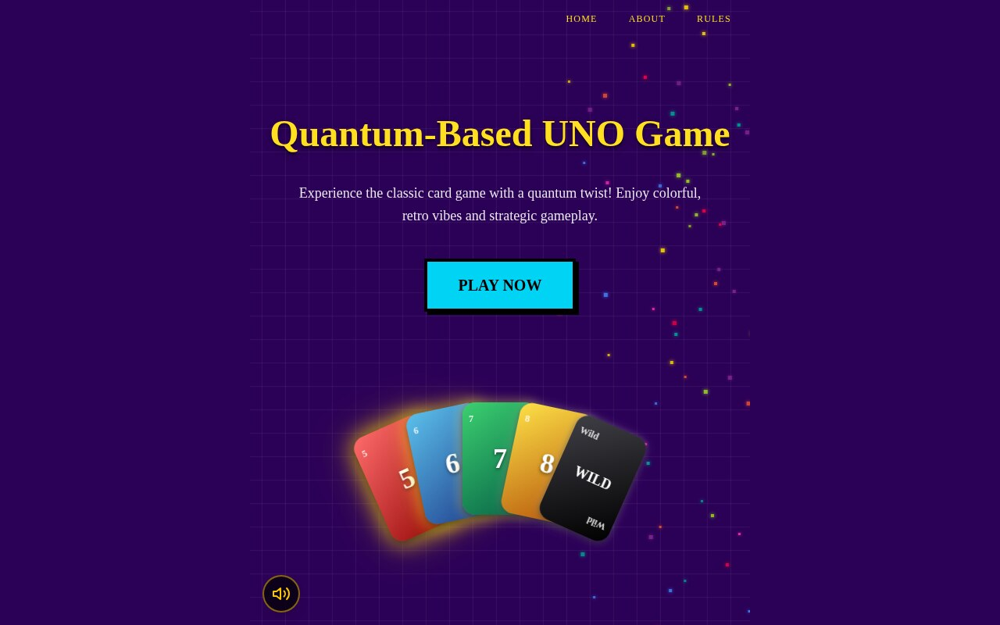

<div align="center">



# Qno

**Uno, except the cards are quantum gates. Superposition is a hand you actually hold.**

[Play it](https://qno.futile.studio) · [Futile Studio](https://futile.studio)

[](https://qno.futile.studio)


[](https://github.com/MayurJivani/Qno-web/commits/main)

</div>

> **Futile Lab** · game, 2024 · live

## Overview

A real-time multiplayer card game that teaches a bit of quantum computing by making you play with it. Uno rules, plus quantum gates, superposition and entanglement as cards you hold in your hand.

The Unity original is in [Qno](https://github.com/MayurJivani/Qno). This is the browser rewrite: 2 to 4 players, one room each, everyone on their own screen.

## How to play

The full rules live on the Rules page in the game. Short version:

- Every card has two faces, Light and Dark. The game starts on Light. You see both sides of your own cards, opponents only see the inactive side.
- 216 double-sided cards, 7 each. Match the top of the discard pile by colour (on the active side), by value, or play a black wild.
- Can't play? Draw one. If it's playable you can play it or keep it.
- First one with an empty hand wins.

**Light side actions**
- **Pauli X**: flips every card to the other side. The discard pile changes, and so do the opponent cards you can see.
- **Teleportation**: steal a card of your choice from an opponent. Not allowed if they only have 1 card left.

**Dark side actions**
- **Pauli Y**: flips every card and reverses turn direction.
- **Pauli Z**: reverses turn direction without flipping. In 2-player games, Pauli Y and Z give you another turn.

**Wild cards**
- **Superposition** (Dark side): saves the current top card. Until it's measured, only Measurement or another Superposition can be played. Everyone else draws until they have one.
- **Measurement**: collapses a Superposition 50/50 (the saved card comes back Light, or comes back Dark and everything flips). On an Entanglement, one entangled player draws 3 and the other draws 0. On a normal card, it reveals the card underneath.
- **Entanglement** (Light side): ties two players together (in 3-4 player games you pick the two opponents). Entangled players can only play Measurement, and when one draws, the other draws too. Everyone else keeps playing. Only one entanglement at a time.
- **Decoherence**: pulls a fresh non-action card from the draw pile onto the discard pile.

The board also has a small Three.js Bloch sphere that shows the current "qubit" state: Light at |0⟩, Dark at |1⟩, on the equator during Superposition.

## Rooms

Create a room, share the room ID, everyone joins with it. All players hit Ready, then the host starts the game. Every game rides a single WebSocket per player, and the server holds the room state. Game actions are bound to the socket's own seat, so a client can't play for somebody else.

## Stack

- **Frontend**: React 19, Vite, Tailwind CSS 4, Framer Motion, Three.js, React Router
- **Backend**: Node, Express 5, `ws`, TypeScript
- **Tests**: Jest (backend: room flow, every card effect, turn handling, validation, edge cases)

## Running it locally

Needs Node (the Docker image uses Node 22).

Build both halves and serve them from one process:

```bash
npm run build     # installs and builds frontend and backend
npm start         # backend on port 3000, serves the built client too
```

Then open http://localhost:3000.

For development, run the two halves separately:

```bash
cd backend && npm install && npm run dev     # nodemon + ts-node on port 3000
cd frontend && npm install && npm run dev    # Vite dev server
```

Without `VITE_WS_URL`, the client connects to the page's own host on port 3000.

Tests:

```bash
cd backend && npm test
```

## Configuration

The backend reads a `.env` in the repo root (optional).

| Variable | Used by | Purpose |
| --- | --- | --- |
| `PORT` | backend | HTTP and WebSocket port, defaults to 3000 |
| `VITE_WS_URL` | frontend, build time | Full WebSocket URL for the client |
| `VITE_WS_PORT` | frontend, build time | Port used when `VITE_WS_URL` is not set, defaults to 3000 |

## Deployment

The `Dockerfile` builds both halves into one Node image. On every push to `main`, `.github/workflows/image.yml` builds it and pushes it to GHCR. `deploy/compose.yaml` runs that image on my server (port 3002, read-only filesystem, no capabilities), and `deploy/qno.caddy` is the reverse proxy block with response buffering turned off so played cards show up on other screens right away.

There's also an older Firebase Hosting workflow for the frontend that runs on the `live` branch.

## Project structure

```
frontend/   React client (landing, rules, about, room, game board)
backend/    Express + ws room server, game logic and Jest tests
deploy/     compose file, Caddy block and box-side deploy script
Dockerfile  single image for both halves
```

## Credits

Made with [Ritwik Garg](https://github.com/ritwikgarg). You can meet us both on the About page.

## Licence

No licence file yet, all rights reserved.

---

<p align="center"><sub>Built by <a href="https://github.com/MayurJivani">Mayur Jivani</a> at <a href="https://futile.studio">Futile Studio</a>. Everything is futile. Do it anyway.</sub></p>
